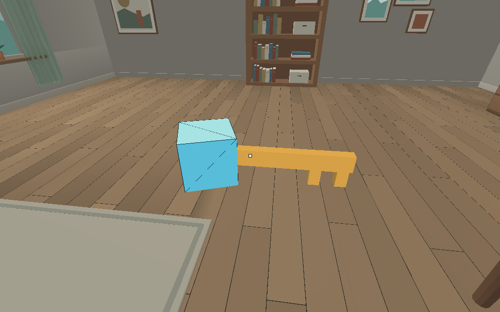
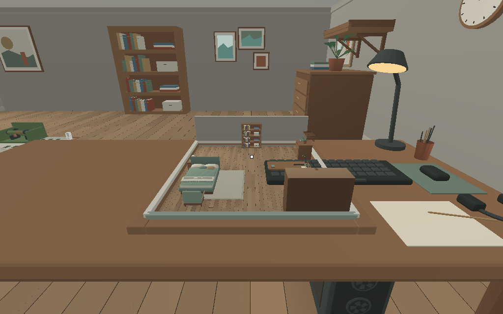

# B-026 — 가이드 없는 열쇠 합성·열쇠 구멍·휴대 미니어처

## 작업 시작

- 2026-11-20 / 최윤서 작업 지원 / `yoon778` `32edad1` 기준 / 완료
- 확인: AGENTS·TEAM·협업 규칙·공식 기획서 내 방, B-025와 공유 SCHOOL-005
- 요청: 방 안 정답 윤곽선 없이 두 물체를 열쇠 모양으로 맞추고 잡아 실제 열쇠로 만들기. 다른 곳의 열쇠 구멍을 장롱에 붙여 열쇠를 넣으면 개방. 네 미니어처도 꺼내 배치
- 범위: HomeRoom, ComputerScreen의 완성 열쇠·휴대 안내, Blender 원본·내보내기·게임 메시·미리보기, 기획서와 이 기록
- 완료 기준: 다른 배치·관찰 시점에서 실제 형태 합성, 자동 장롱 해제 없음, 열쇠·구멍 두 조건과 물건 소실·중복 방지, 네 모형 이동 후 내부 연동·기존 탈출, 두 빌드와 실제 OpenGL 검증
- 역할: Home 코드 / 컴퓨터 표시·문서·빌드·Git / Blender·형식 / 임시 QA로 파일 분리

## 진행·인계

- 제거 대상은 장롱 앞 정답 윤곽선과 숨겨진 고정 배치·관찰점 판정. 컴퓨터 안 도형 문제의 밝은 틀은 유지
- 두 물체가 열쇠처럼 보일 때 E로 잡아 완성 열쇠 하나로 전환. 장롱은 이때 열리지 않음. 다른 곳에서 구멍판을 가져와 붙인 뒤 열쇠를 넣어 개방
- 완성 열쇠 제작에 쓴 큐브·조각은 소비. 이후 컴퓨터에서 새 큐브를 다시 꺼내 기존 발판 퍼즐을 진행할 수 있게 연결
- 미니어처는 전시판 모서리를 E로 잡고, E로 놓고, 든 채 휠로 회전. 통째로 옮기는 것은 전시 위치 변경이며 실제 방 전체를 이동시키지 않음. 내려놓은 모형 안의 책장·벽·빗장·군대 RPG 연동은 유지
- 학교·회사 모형은 기존 대표 형태 유지, 새누 원본 연결 후속. 학교·회사 소스와 공용 Player는 수정 대상 아님
- 공유 기준: `origin/main` `4e55819`, `origin/saenu` `cf997cb`; 추가 공유 변경 없음
- Blender: 관통 열쇠 구멍판·책상 받침, 네 전시판 분리. 20개 고정 메시 범위·69,076삼각형. 원본 별도 재내보내기 SHA256 `ED9AAC5A51F0CD736A27CE0FE56CBBC71BFD85204474301D9D9FD67410FE34A9` 일치
- 컴퓨터 화면 단독 검증: 새 휴대 안내·완성 열쇠 렌더를 포함한 소스에서 기존 문제 10검사 통과
- Debug·Release x64 빌드 통과. 실제 OpenGL에서 다른 배치·시점 A/B의 열쇠 합성, 구멍판·열쇠 양순서, 재집기·중복 방지, 플레이어·큐브의 문 스윕 보호 통과
- 네 전시판의 실제 가장자리 회수·휠 15도 회전·중력 배치 통과. 옮긴 내 방(책상·yaw 0)과 군대(바닥·yaw 180도)에서 책장·RPG·작은 벽 착탄과 실제 벽 동시 파괴·빗장·실제 선반 점프·문짝·걸어서 탈출까지 연결 206검사 통과. 내 방 모델 전체 이동은 실물 방 전체 이동을 뜻하지 않음
- 컴퓨터 기존 문제·반환·상태·렌더 회귀 45검사, main 컴퓨터 입력·일시정지 29검사, 새 열쇠/구멍판 선행 절차와 이동한 F4 모형의 방 전환·정지 보존 등 41검사 통과. 합계 321검사·실패 0. 위 단독 컴퓨터 10개는 별도이며, 입력은 검증 코드가 자동 호출함
- 회사 모형의 안쪽은 의자 등 소품이 먼저 맞을 수 있음. 실제 외곽 테두리에서 회수하는 fixture로 통과, 제품 코드 수정 없음
- 미검증: 직접 키보드·마우스 완주, 첫 발견 난이도, 다른 GPU
- 로컬 커밋·원격 푸시: 이 기록을 작업 파일과 함께 `yoon778`에 커밋해 `origin/yoon778`로 공유
- main 통합: 이번 작업에는 미요청

## AI 활용

- 사용자 요청에 따른 화면상 형태 합성·물건 결합·모형 이동과 내부 연동을 C++·Blender로 구현하고 자동 검증
- 사람의 확인: 새 기능 미확인

## 수정 파일·인계

- `rooms/home/HomeRoom.h`, `HomeRoom.cpp`: 자유 화면상 열쇠 형태 판정·실물 합성·물리적 열쇠/구멍판·장롱 안전 개방·네 모델 운반과 내부 동적 변환
- `rooms/home/ComputerScreen.h`, `ComputerScreen.cpp`: 완성 열쇠 렌더·종류별 휴대 안내. 기존 컴퓨터 두 문제 유지
- `rooms/home/HomeGeometry.inc`, `rooms/home/design/build_home.py`, `export_geometry.py`, `내 방.blend`, `home-preview.png`, `miniature-preview.png`: 분리한 전시판과 실제 관통 구멍판의 원본·게임 메시·미리보기
- `rooms/home/design/game-preview.png`, `key-puzzle-preview.png`: 실제 OpenGL의 책상 위로 옮긴 내 방 모형, 정답선 없는 열쇠 조립 화면. PNG 형식 변환이며 연속 수동 플레이 영상이 아님
- `illusion-escape-game-plan.md`, `docs/tasks/B-026.md`: 최종 흐름·소비/재출력 규칙·검증·이동과 내부 연동 구분
- 임시 QA 드라이버는 `%TEMP%/out-of-scale-home-free-key-*-20261120`에 분리. 제품에 테스트 전용 조작·단축키 추가 없음
- 재검증: `qa`, `computer-qa` 폴더의 `compile-driver.cmd` → `link-run.cmd`, 두 `integration-qa` 폴더의 `run.cmd`. 새 Release 개체 파일을 링크한 비표시 OpenGL 드라이버로 확인, 실제 키보드·마우스 조작감 검수와 구분
- 네 묶음 일괄 재현: `powershell -NoProfile -ExecutionPolicy Bypass -File "$env:TEMP/out-of-scale-home-free-key-qa-20261120/run-all.ps1"`. 실행 후 `all-results.txt`에서 `FINAL CHECKS 321 PASSED: 206+45+29+41` 재확인
- 새누 인계: 공용 main·Player·학교·회사 구현 변경 없음. 이 브랜치를 받은 뒤 B-026 확인, 학교·회사 실제 원본 모형 연결은 후속. 새 공용 규칙 추가 없음

## 화면

