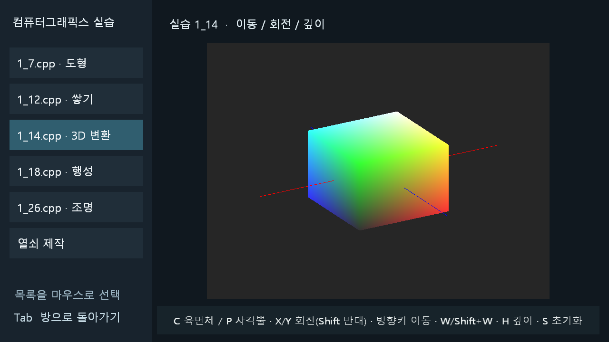
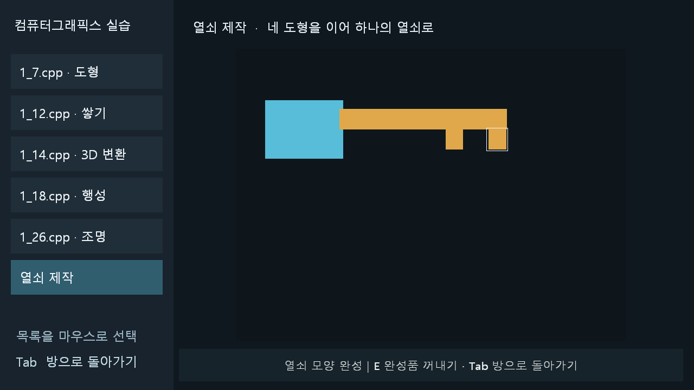
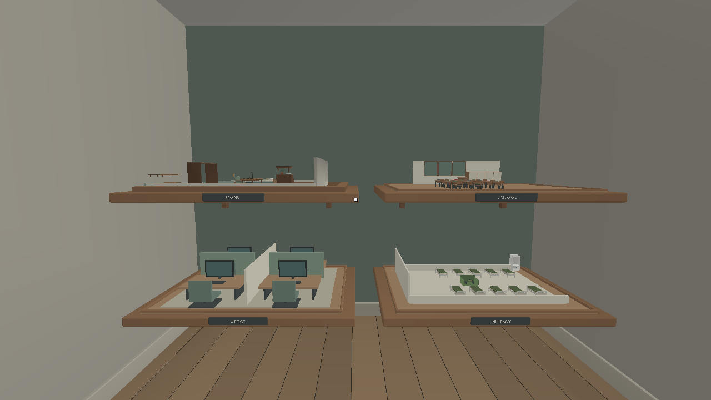

# B-028 — 수업 실습 컴퓨터·열쇠 제작·비밀 전시실

## 작업 시작

- 2026-11-20 / 최윤서 작업 지원 / `yoon778` `fbd2109` 기준 / 완료
- 사용자 요청: 왼쪽 실습 목록을 마우스로 선택해 원본처럼 조작하는 5개 실습. 수업 물건은 꺼내지 않고 별도 열쇠 제작에서 완성 열쇠만 E 출력. 구멍판은 벽 그림에 숨기고 기존 장롱 앞 두 거치대 제거. 모형 안 RPG는 작은 장비처럼 배치
- 사용자 선택: 장롱을 열면 뒤 비밀 공간에 들어가 2×2 모형을 조작하는 방식. 큰 판이 벽에서 튀어나오는 대안은 채택하지 않음
- 확인: AGENTS·TEAM·협업 규칙·공식 기획서·B-026/027·공유 SCHOOL-005/GIT-20261120-01. 현재 main/saenu `a1c53a3`, 로컬은 사용자가 main을 합친 `fbd2109`. 기존 수정 없음
- 범위: HomeRoom·ComputerScreen/수업 화면 모듈, 필요한 main 마우스 전달과 프로젝트 등록, Blender 내 방 원본/게임 메시, 이 기록·기획서. 학교·군대·Player 구현은 수정하지 않음
- 완료 기준: 5개 수업의 원본 특징·입력, 전체화면 컴퓨터 목록 마우스와 공통 정지/복귀, 수업 물건 방출 차단, 조립 완성 열쇠 1개 출력·그림 구멍판·개방, 연속 보행 비밀실 진입·4모형 내부 상호작용·기존 도보 탈출, 두 빌드·숨김 OpenGL 검증

## 구현 계약

- 수업: practice_1_7/1_7.cpp, practice_1_12/1_12.cpp, practice_1_14/1_14.cpp, practice_1_18/1_18.cpp, practice_1_26/1_26.cpp. 원본 경로는 사용자 지정 컴퓨터그래픽스 실습 폴더이며 읽기만 수행
- 좌측 6행: 5수업 + 새 열쇠 제작. 실제 수업 조작은 해당 화면에 전달하고 Tab·Esc·F1~F4는 게임 공통 입력 유지. 1_7의 E는 선 생성이며 월드 물건 출력 아님
- 컴퓨터 사용 중 포인터를 보이고 전체 창에 실습 UI를 확대. 정지·복귀·방 전환에서 FPS 입력이나 RPG 사격이 새지 않게 분리
- 원래 컴퓨터 발판 큐브 공급은 제거. 높은 선반 문짝 퍼즐이 막히지 않도록 방 안의 독립 원목 상자를 기존 집기·낙하·발판 물리로 관리. 수업 물건을 몰래 꺼내는 경로를 두지 않음
- 그림을 E로 열어 안의 구멍판을 발견·회수. 완성 열쇠와 구멍판의 설치·장롱 개방·중복 방지는 기존 원칙 유지
- 장롱 뒤 실제 공간 확장, 2×2 모형 전시는 실제 작은 방으로 걸어 들어가 조작. 내 방 모형은 늘어난 실제 구조를 같은 비율로 반영. 모형의 책장·벽·빗장 연동 유지
- 담당 분리: ComputerScreen/수업 모듈·수업 자산, Blender/내보내기, Home/main/프로젝트/문서, 임시 QA. 같은 파일 동시 수정 없음
- 사람의 새 구성 직접 확인: 미확인
- 공유: 이 기록과 작업 파일을 함께 yoon778에 커밋해 origin/yoon778로 푸시. 기존 사용자 병합 fbd2109를 보존. 이번 기능의 main 통합은 미요청

## 검증·인계 진행

- Debug·Release x64 빌드 통과. Release는 명령에만 `WholeProgramOptimization=false`를 지정한 검증이며 기본 LTCG 링크 완료를 뜻하지 않음
- 컴퓨터 78검사 통과: 원본 다섯 실습의 조작·변화, 1~5 출력 차단, 목록 클릭과 두 종횡비, 실제 마우스 드래그 조립·오답/정답·중복 방지, 정사각형 90도/직사각형 180도 동형, OpenGL 상태 복구
- 깊이 ON/Phong ON 초기 화면과 실제 파일명 목록의 PNG도 판독. 원본 실습 실행 창을 동시에 비교한 결과는 아니며 원본 코드/셰이더/메시 대조와 새 렌더 확인으로 검수
- Home 연결 59검사 통과: 공개 조립·출력, 그림 뒤 구멍판 발견, 설치·열쇠 삽입, 잠긴 장롱·주변 우회 차단, 연속 충돌 이동으로 비밀 전시실 진입, 작은 책장·RPG·벽 연동, 실제 상자 집기·점프·착지·문짝 장착, 정면 빗장 관통 차단·후면 해제·문 열기·걸어서 탈출. RPG 사용 후 손이 비워져 상자를 바로 집을 수 있음
- main 입력 37검사 통과: 컴퓨터 진입/재개 포인터 NORMAL·Tab 복귀 DISABLED, 왼쪽 파일 클릭, 1_7 E 선 생성·수업 방출 없음, press/repeat/release·포커스 입력 해제, FPS 이동·점프·시점·RPG 발사 누수 없음, F1/F4 학교 카메라·공책 및 내 방 선택 수업·조립·플레이어 상태 유지. 합계 174검사·실패 0, 숨김 OpenGL 합성 입력이며 사람 직접 키보드/마우스 검수와 구분
- Blender 원본을 별도 재내보내기하여 게임 메시와 SHA256 `D4E50F5F19072961FFEB56212FFC22A24414CA6A586C2FCA9A716013C1883C05` 일치 확인. 22범위·69,984삼각형
- 원본 구 메시 복사본 SHA256 `0D69221C8F6F6AAF8192C6647A325B6DA00E7723E3335AF14E9D6C0240EB7C52` 일치. 프로젝트에서 실행 폴더에도 해당 메시를 복사
- CopyHomeCourseworkModel 타깃을 Debug/Release 각각 실행해 출력 메시 해시 일치 확인. 프로젝트 XML·UTF-8·이 기록의 이미지 링크·git diff --check 통과
- 새누 인계: 자기 방의 컴퓨터 화면에만 마우스/키를 전달하는 main 분기를 추가. F1~F4·Esc·Tab 공통 예약 유지, 실습 숫자키는 실습에 전달. 학교/군대/Player 소스는 그대로 보존
- 커밋 직전 공유 재확인: main/saenu `a1c53a3`의 GIT-20261120-02 및 SCHOOL-006~008 확인. 새누의 학교→군대 자동 연결 `f045413`은 이 로컬 기준 뒤 원격 변경이며 main.cpp의 학교 반환 구간, 이번 컴퓨터 입력 구간과 다름. 이후 main 병합 시 이 연결과 양쪽 검증을 함께 유지해야 함. 이번 작업에서 다른 담당 새 커밋을 임의로 합치지 않음

## 수정 파일·재현

- `rooms/home/ComputerScreen.h/.cpp`: 목록·TV FBO·전체 화면 실습 UI·완성 열쇠 출력 게이트
- `rooms/home/CourseworkLabs.h/.cpp`, `rooms/home/coursework/sphere.obj`, `SOURCES.md`: 수업 어댑터·원본 메시·출처와 이식 차이
- `rooms/home/HomeRoom.h/.cpp`: 그림·구멍판·비밀실 경계/충돌·새 모형 좌표·작은 RPG·실제 발판 상자·화면 입력 전달. 구멍판과 삽입한 열쇠는 열린 장롱 문을 따라 이동해 통로 중앙에 남지 않음
- `project_code/Out_of_Scale/main.cpp`, `Out_of_Scale.vcxproj`, `.vcxproj.filters`: 컴퓨터 포인터·키/마우스 전달·커서 복귀, 소스 등록·메시 출력 복사
- `rooms/home/design/build_home.py`, `export_geometry.py`, `내 방.blend`, `home-preview.png`, `miniature-preview.png`, `rooms/home/HomeGeometry.inc`: 비밀실·그림·거치대 제거·소형 RPG·상자 원본/게임 메시
- `rooms/home/design/game-preview.png`, `key-puzzle-preview.png`, `computer-preview.png`: 실제 OpenGL 전시실·키 제작·수업 UI 화면. PNG 캡처이며 사람의 연속 플레이 영상이 아님
- `illusion-escape-game-plan.md`, 이 기록: 최신 흐름·조작·제약·인계
- UI 재현: `%TEMP%/out-of-scale-home-lessons-qa-20261120/run-lessons.cmd`
- Home 재현: `%TEMP%/out-of-scale-home-secret-qa-20261120/compile-driver.cmd` → `link-run.cmd`, 결과 `route-results.txt`
- main 재현: `%TEMP%/out-of-scale-home-lessons-main-qa-20261120/run.cmd`, 결과 `results.txt`. 임시 Player/Pause/SchoolPreview 래퍼는 관측용이며 제품 파일 수정 아님
- 초기 깊이/Phong 화면은 `%TEMP%/out-of-scale-home-coursework-default-frames-20261120/`에 별도 캡처

## 화면

## AI 활용

- 사용자가 제공한 수업 소스의 도형·색·변환·조명 식·조작을 참고해 한 OpenGL 문맥 안의 실습 어댑터를 구성. 수업 원본 파일은 보존
- AI 지원 범위: 목록 UI·FBO·입력 라우팅·열쇠 제작 판정, Blender 비밀 전시실/그림/상자, 기존 물리와 퍼즐 연결, 자동 검증
- 사용자 선택 반영: 큰 모형판 돌출 대신 장롱 뒤 비밀 공간. 새 구성의 사람 직접 플레이·발견 난이도·조작감은 미확인
- 한계: 학교·회사 모형은 기존 대표 형태이며 실제 새누 원본 연결은 후속. B-027의 물건 시야 옆 배치 진단은 이번에 수정하지 않았음. 이동한 전시판의 극단 배치 조합·다른 GPU·모든 모니터 비율은 이번 실행 범위 밖
