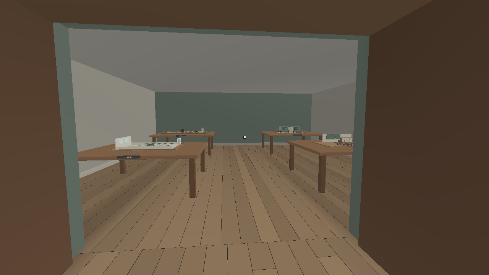

# B-029 — 넓은 비밀 전시실과 XZ 2×2 모형 배치

## 작업 시작

- 2026-11-20 / 최윤서 작업 지원 / `yoon778` `843cb8e` 기준 / 완료
- 요청: 방을 넓히고 Y축 2단 배치를 없애 같은 높이의 XZ 평면에 모형 네 개 배치
- 범위: 비밀 전시실 Blender 원본·게임 메시·미리보기, HomeRoom 경계/충돌·전시대·모형 좌표, 기획서·이 기록
- 확인: AGENTS·TEAM·협업 규칙·공식 기획서·B-028. 원격 main/saenu a1c53a3의 GIT-20261120-02 확인. 기존 수정 없음
- 완료 기준: 같은 높이의 모형 네 개가 X/Z 두 행·두 열, 모형 사이와 외곽 실제 보행, 잠긴 전시실 우회 차단, 책장·RPG·벽·빗장·발판·문·탈출 유지, 두 구성 빌드와 해당 공개 경로 검증

## 구현 계약

- 비밀 전시실만 가로·깊이 확대. 기존 침실·장롱 출입구 유지, 천장 높이 3.2m 유지
- 모형 원점 Y=.95m 공통. 앞줄 학교(.4,.95,9.3)·군대(5.6,.95,9.3), 뒷줄 회사(.4,.95,14.2)·내 방(5.6,.95,14.2). 독립 전시대 4개로 교체
- 전시대 약2.65×2.35m, 중앙 통로 약2.5m와 외곽 보행 여유. 최종 모델 받침·접촉 높이·충돌은 Blender 실측 기준
- 내 방 모형은 확장된 실제 구조를 .075배로 유지하고 전체 메시를 재중앙화해 전시판 밖으로 삐져나가지 않게 조정
- 커진 방에 맞게 Player에 전달하는 Home halfSize와 방별 경계·물건 배치 범위도 확장. 기존 침실 외부나 장롱 옆으로 우회하는 경로는 차단
- 학교·군대·공용 Player·main·컴퓨터 실습 코드 수정 없음. 이번 배치 변경에 영향받는 보행/상호작용 경로를 검사하며 기존 실습 전체 검사를 불필요하게 반복하지 않음
- 담당 분리: Blender/메시·코어 HomeRoom·임시 QA·문서/빌드/Git. 같은 파일 동시 수정 없음
- 이 기록과 변경을 함께 yoon778에 커밋해 origin/yoon778로 푸시. main 통합 미요청
- 사람의 직접 조작·배치 선호도: 미확인

## 실제 변경·검증

- 독립 전시대 4개 크기 2.65×2.35m, 중앙 양방향 통로 2.55m. 각 모형 원점은 Y=.95m로 동일. 받침 밑면에 맞춰 전시대 상판 윗면은 학교 .9365m, 군대/회사 .9265m, 내 방 .9350m
- Player에 전달하는 Home halfSize=20, 실제 전시실 보행 X[-1.50,7.50]/Z최대16.25로 확장. 기존 침실 경계는 유지하고 장롱 외 앞벽·후벽 충돌로 우회/이탈 차단
- 내 방 모형은 전체 원본 X[-6.04,7.93]/Z[-8.89,16.68]를 기준으로 sourceOffset(-.945,0,-3.895), 배율 .075 유지. 받침1.15×2.05m 안에 재중앙화
- 4개 상판·16개 다리·장롱 frame3개 충돌체 정합. 기존 전체 앞벽의 가상 RPG 차단을 실제 분할 벽에 맞추고 확장 바닥·천장 광선 범위 동기화
- Debug·Release x64 빌드 통과. Release는 명령에만 WholeProgramOptimization=false 적용, 기본 LTCG 링크 검증은 아님
- 최신 Release 개체 파일을 연결한 숨김 OpenGL 공개 경로 75검사·실패0. 동일높이/XZ행열, 잠긴 입구·옆 우회 차단, Player 기반 중앙/행사이/양옆/뒤 통로 9지점·뒤벽 차단, 새 좌표 모형 책장·RPG·벽·뒤 빗장, 실제 상자 점프/착지·문짝·걸어서 탈출 확인
- 실제 입구·중앙·후열 캡처 판독. 입력은 검증 드라이버의 합성 호출이며 사람의 키보드/마우스 완주·실시간 조작감과 구분
- Blender 별도 재내보내기와 게임 메시 SHA256 `8343DE8E1A0802A31879F1D7BB468CC5105C0588FFF0A446450D028A70B388A5` 일치. 22범위·71,272삼각형. 기존 퍼즐 소품 메시 보존
- 미검증: 사람의 처음 발견·공간 선호도, 다른 GPU/모니터, 모든 전시판 운반/극단 배치 조합. 컴퓨터/UI/main 소스는 변경0이므로 B-028 전체 검사를 반복하지 않음

## 파일·재현·인계

- `rooms/home/HomeRoom.h/.cpp`: 경계·상호작용 좌표·전시대 충돌·내 방 모형 행렬
- `rooms/home/design/build_home.py`, `내 방.blend`, `home-preview.png`, `miniature-preview.png`, `rooms/home/HomeGeometry.inc`: 공간/전시대·같은높이 원본·게임 메시·모델 미리보기
- `rooms/home/design/game-preview.png`: 실제 입구에서 본 평면 2×2 전시실. PNG이며 연속 수동 플레이 영상 아님
- `illusion-escape-game-plan.md`, 이 기록: 최신 배치·검증·공유 범위
- 재현: `%TEMP%/out-of-scale-home-layout-qa-20261120/compile-driver.cmd` → `link-run.cmd`, 결과 `route-results.txt`. 임시 드라이버/캡처는 같은 폴더에 분리
- 새누 인계: 학교·군대·Player·main·컴퓨터 실습 코드 수정 없음. 원격 main의 학교 자동 연결은 이후 사용자 main 병합 요청 시 양쪽 변경을 유지해 검증할 대상

## AI 활용

- 사용자 배치 변경에 따라 Blender 공간·모형 배치, C++ 경계/좌표/광선·물리 충돌을 함께 조정하고 공개 경로 자동 검증
- 사람의 새 구성 직접 확인은 미확인

