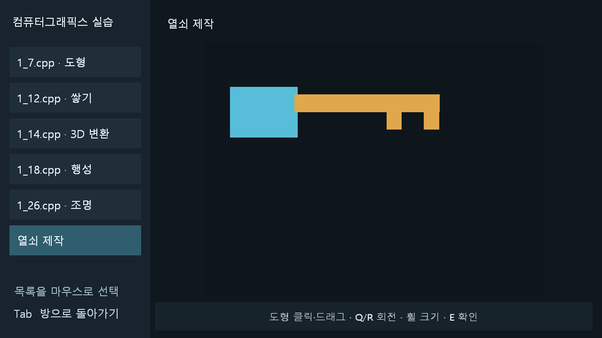

# B-030 — F4 퍼즐 설명·가이드 표시 제거

## 작업 시작

- 2026-11-20 / 최윤서 작업 지원 / yoon778 03d6b0c 기준 / 완료
- 요청: 설명 글과 선으로 정답을 쉽게 알려주지 않도록 제거
- 사용자 확인: 수업 조작법·파일 목록 유지
- 범위: F4 컴퓨터의 열쇠 설명/완성/오답 문구·선택 윤곽선, 물건별 반복 HUD, 문짝 정답 위치 미리보기와 빗장 완료 강조색. 조립·출력·설치·상호작용 판정은 유지
- 기존 수업 5개의 선 도형·점선·축·궤도·와이어는 실습 내용이므로 보존. 모형 명패는 장소 이름이며 풀이 설명이 아님. 학교·군대·main·Player·Blender 모델은 수정하지 않음
- 확인: AGENTS·TEAM·협업 규칙·기획서·B-028/029·공유 GIT-20261120-02. 시작 작업 트리 깨끗함, 사용자가 main을 합친 03d6b0c 보존
- 완료 기준: 기본 조작·파일 선택을 보존하면서 정답을 알려주는 표시가 나오지 않음, 빌드와 실제 OpenGL 캡처 확인
- 표시 변경이므로 새 테스트나 전체 75/174검사 반복 없이 기존 캡처 도구로 필요한 화면만 확인
- 작업 후 기록과 변경을 yoon778에 커밋·푸시. main 통합 미요청

## 변경·검증·인계

- ComputerScreen: 조립 순서 설명·완성/오답/꺼냄 상태 문구·물건별 들기 HUD와 관련 텍스처/표시 API 제거. 파일 목록·수업 제목·기본 조작법은 유지. 열쇠 확인은 E를 눌렀을 때만 판정
- CourseworkLabs: 새 열쇠 제작 화면의 흰 선택 윤곽선만 제거. 선택/끌기/회전·크기 조절과 다섯 원본 실습의 도형선·점선·축·궤도는 보존
- HomeRoom: 정답 문틀에 띄우던 녹색 문 미리보기·빗장 완료 강조색·들고 있는 물건 안내 호출 제거. 문짝을 손에 들고 있는 실제 표현과 설치/빗장 판정은 유지
- 사용하지 않는 보조 큐브 외곽선 렌더도 제거. Blender 실제 형상·모형 명패·열린 출구의 조명 표현은 변경하지 않음
- Debug·Release x64 빌드 통과. Release는 검증 명령에만 WholeProgramOptimization=false 지정, 기본 LTCG 링크 완료를 뜻하지 않음
- 기존 도구의 표시 전용 3프레임 캡처: 미완성·완성 열쇠 화면에 상태 문구/흰 선 없음, 파일 목록/조작법 유지. 실제 공개 마우스 조립 후 E로 완성키가 출력되어 active=0/held=1/keyTaken=1 관측, 월드 HUD 없음. 3개 draw OpenGL 오류 없음
- 문 미리보기·빗장 강조색 제거는 소스 대조로 확인. 표시 변경이므로 전체 75/174개 회귀 검사와 새 테스트는 실행하지 않음. 사람 직접 조작·발견 난이도 평가는 미확인
- 임시 캡처/로그: %TEMP%/out-of-scale-home-hint-visual-20261120/ — compile-driver.cmd → link-run.cmd, route-results.txt 및 workshop-unsolved.png/workshop-solved.png/world-held-complete-key.png
- 수정 파일: rooms/home/ComputerScreen.h/.cpp, CourseworkLabs.cpp, HomeRoom.cpp, design/key-puzzle-preview.png, illusion-escape-game-plan.md, 이 기록
- 새누 인계: F4 내부 표시 전용 변경, 학교·군대·main·Player·공용 입력 API 변경 없음. 제거된 ComputerScreen 들기 안내 API는 Home 전용이며 제품 내 다른 호출 없음 확인
- 이 기록과 작업 파일을 함께 yoon778에 커밋해 origin/yoon778에 공유. main 병합 미요청

## AI 활용

- 사용자 확인에 따라 수업 조작법과 퍼즐 풀이 힌트를 분리해 표시 코드를 정리하고 실제 OpenGL 프레임 확인
- 사람이 새 화면을 직접 검토했는지는 미확인

