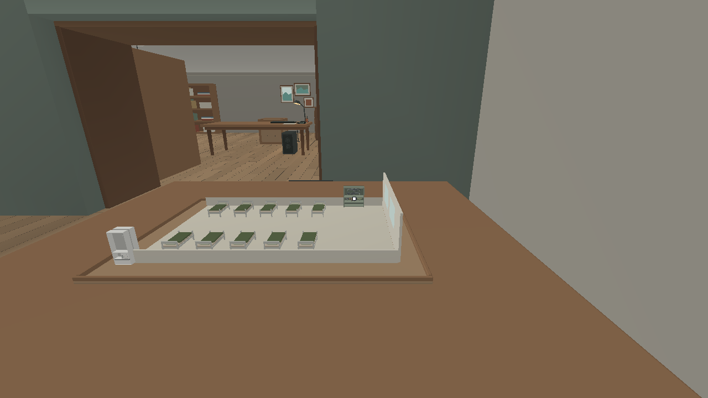
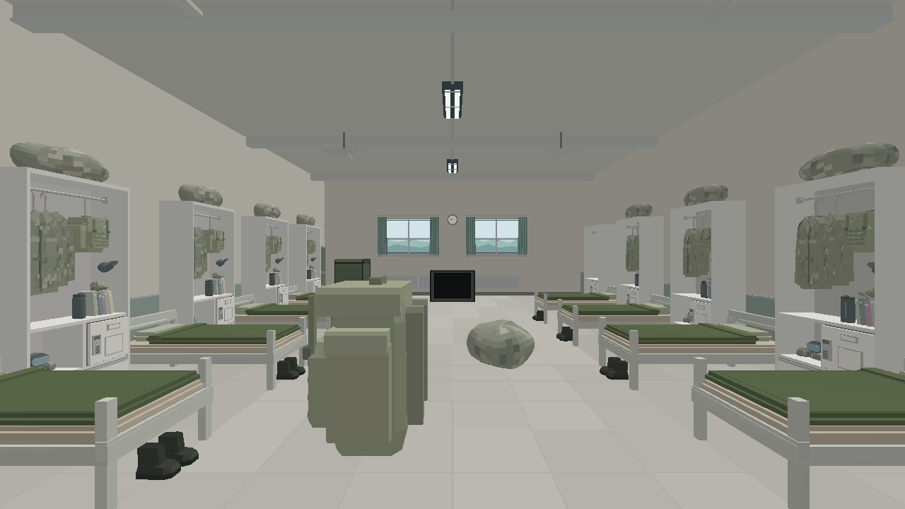

# B-031 — 모델링 점검 결과 반영

## 작업 시작

- 날짜 / 담당: 2026-11-21 / 최윤서 작업 지원
- 상태: 완료 / 브랜치 yoon778 / 시작 193d592
- 확인: AGENTS, TEAM, AI 협업 규칙, 공식 기획서 군대·내 방, B-029·030, 공유 GIT-20261120-02
- 목표: 군대 미니어처의 실제 형상과 충돌·가림·집기 판정을 일치시키고 RPG를 실제 생활관 총기함 위치로 옮김. Blender 재질의 인상을 기존 게임 메시 형식 안에서 개선
- 범위: HomeRoom.cpp, 내 방 Blender 생성·내보내기와 원본·게임 메시·미리보기, 군대 재질 내보내기와 게임 메시, 이 기록
- 제외: 학교·회사·Player·main·공용 렌더러/API·퍼즐 규칙 변경, 유료 생성·외부 업로드, main 병합
- 완료 기준: 같은 변환으로 렌더·가림·집기 처리, 보이지 않는 과대 충돌 제거, RPG 꺼내기 이후 기존 탈출 흐름 유지, Blender 원본과 게임 메시 재생성 가능, 관련 빌드·OpenGL 검증
- 병렬 작업: 자산은 별도 codex/b031-model-art worktree, C++·기록은 yoon778. QA는 제품 파일을 수정하지 않고 임시 폴더 사용

## 진행·인계

- 원격 확인: 작업 시작 fetch 후 origin/main·origin/yoon778 추가 커밋 없음. 새누 SCHOOL-006·007·008의 main 공유 기록 확인, 기존 학교 연결·최적화·공책 작업 보존
- 기존 정확 치수 모델 수정이므로 session-default의 Blender 직접 작업 경로 적용
- 재질 개선 범위: 기존 position/color 형식을 유지한 오프라인 베이크. 실시간 PBR·법선맵·UV 렌더러 도입 아님
- HomeRoom: 군대판 충돌 Y[-.0235,.44]의 예전 상단을 실제 형상에 맞춰 .24로 보정. 동일 helper로 렌더·RPG 집기·가림 변환을 공유해 .8배 받침/RPG의 잔존 가림 제거
- RPG·총기함: 임의 초록 받침 대신 F2 원본 RPG 10개 부품과 총기함/K2 86개 부품 재사용. F2 기준점 (8.3,0,-5.2)에 대해 .075배 축소, 원래 방향 유지. 군대판 local RPG (.42075,.057,-.364125), 총기함 (.420,.07425,-.363375). 군대판 이동·회전에도 함께 적용
- 원본 RPG는 미터 단위로 교체되어 손에 그리는 배율만 .37로 조정, 이전 손 화면 크기 약 .56m 유지. 발사·벽 파괴·문·빗장 규칙 변경 없음
- 오프라인 material_bake: 기존 재질의 저주파 질감 명도·범프 음영·거칠기/금속의 고정 하이라이트를 RGB에 근사. 원본의 모든 노드를 평가하는 기능이 아니며, 시점에 따른 실시간 반사와 회전 후 동적 재조명은 제공하지 않음. 발광·달·별빛·unlit 원색 유지
- 군대 정점 271,701개와 모든 좌표·배치 구간·달 메타데이터 동일, 색상만 51,717개 변경. Home 22범위·72,456삼각형, 이전 71,272 대비 약1.66% 증가는 실제 RPG/총기함 교체분. 나머지 20범위 정점 좌표는 정확히 동일. 질감용 추가 분할·실행 중 재질 계산 없음
- Blender 5.2.2 LTS에서 두 맵 내보내기 성공. 최종 Home 반복 내보내기 SHA256 `612467E1E705EA9BD3E08BCCBCFE5EB7BAA5E3AE66F0476859962F3BE6023E52` 일치
- Debug·Release x64 빌드 통과. 기본 호스트 컴파일러의 C1060 이후 검증 명령에 PreferredToolArchitecture=x64 지정, 제품 빌드 설정 수정 없음. Release는 기존 검증 방식대로 명령 한정 WholeProgramOptimization=false 적용, 기본 LTCG 링크 검증은 아님. 기존 glew32s.pdb 누락 LNK4099 경고는 남아 있음
- 최신 Release 개체에 연결한 숨김 OpenGL 공개 경로 자동 검증 82/82 통과. 새 총기함 앞에서 E로 RPG 집기, 모형 위 빈 공간 조준 시 옛 .8배 받침의 2m 이내 조기 탄착 없음, 이후 작은 벽 재발사·붕괴, 크레이트 점프·문짝 회수/확대/설치·뒤 빗장·실제 문 열기·걸어서 탈출까지 확인
- 같은 크레이트를 군대판 위에 공개 집기/E 놓기로 떨어뜨려 중심 Y=1.69±.003m 착지 확인(지지면 .95+.24=1.19). 옛 .44 높이에 떠 있지 않으며 회수·원위치 복원 후 문짝 경로 계속 진행
- 실제 게임 native 프레임 13장 생성, 총기함 새 위치·넓은 전시실 화면 직접 판독. 입력은 검증 드라이버의 합성 호출이며 사람의 물리 키보드/마우스 완주가 아님
- F2 추가 native 캡처에서 일부 장구류가 흰색으로 바뀌는 베이크 오류 발견·수정. 기존 OOS military prop은 노드 연결 여부와 관계없이 diffuse_color에 실제 팔레트를 지정하고 Principled에는 기본 흰색을 남긴 재질임을 실측. 베이크 기본색은 항상 기존 diffuse_color를 사용하고 roughness·metallic·bump만 근사하도록 보정. 실제 군장 RGB(.506,.517,.437), 의류 RGB(.309,.350,.368)가 기존 내보내기와 일치함을 검사
- 색상 보정 후 두 맵의 모든 정점 좌표/구간 메타데이터가 기존 검증 대상과 같고 RGB가 유한한 [0,1] 범위인지 확인. 82개 기능 검사는 반복하지 않고 최종 빌드·3장 render-only 캡처를 갱신. 마지막 Home 2장은 private 상태로 전시실을 연 렌더 전용 화면이며 기능 검증 결과와 구분
- 최종 Debug·Release 재빌드 통과. 최종 native 캡처 3장과 GL 오류 없음 확인, 실제 이미지에서 군장 올리브·의류 위장 패턴·어두운 셔츠·총기함 색상 보존 확인. 최신 이미지를 제품의 미리보기 파일에 반영
- 독립 읽기 검토: 소품 변환·상태 분기·bounds 포함 관계, 재질 fallback·색 범위·발광 분기에서 변경 코드 버그 발견 없음. 실행 검증과 구분
- 수정 파일: rooms/home/HomeRoom.cpp, HomeGeometry.inc, design/build_home.py·export_geometry.py·내 방.blend·game-preview.png·miniature-preview.png·military-miniature-preview.png, rooms/military/design/export_geometry.py·military-material-game-preview.png·MilitaryGeometry.inc, rooms/shared/design/material_bake.py, 이 기록
- 재현: %TEMP%/out-of-scale-home-b031-qa-20261121/의 compile-driver.cmd → link-run.cmd, route-results.txt와 build-debug.log·build-release.log·export-home.log·export-military.log. 검증 도구·재내보내기 비교본은 제품에 추가하지 않음
- 미검증: 사람의 실제 입력·발견 난이도·주관적 품질, 다른 GPU/모니터의 실시간 FPS. 프레임 유지 보장으로 해석하지 않음
- 새누 인계: 학교·회사·공용 C++ 인터페이스·main 수정 없음. 새 shared/design/material_bake.py는 두 맵의 오프라인 내보내기에서만 사용하는 Python 내부 도구. 새누 담당 exporter에서 호출하도록 바꾸지 않음
- 커밋 직전 공유 확인: fetch 후 origin/main a1c53a3·origin/saenu a1c53a3·origin/yoon778 193d592 추가 변경 없음. 공유 AGENTS·TEAM·GIT-20261120-02 및 관련 학교 작업 기록 확인, 담당 범위 충돌 없음
- 로컬 커밋 / 원격 푸시: 변경과 이 기록을 한 커밋으로 yoon778에 저장해 origin/yoon778에 공유. 원격 HEAD 일치는 푸시 직후 확인
- main 통합: 미요청·미수행
- AI 요청 요약: 직전 원본/코드 감사에서 확인한 판정·배치 불일치 및 재질 전달 한계 개선
- 사람의 직접 조작·새 화면 검토: 미확인

