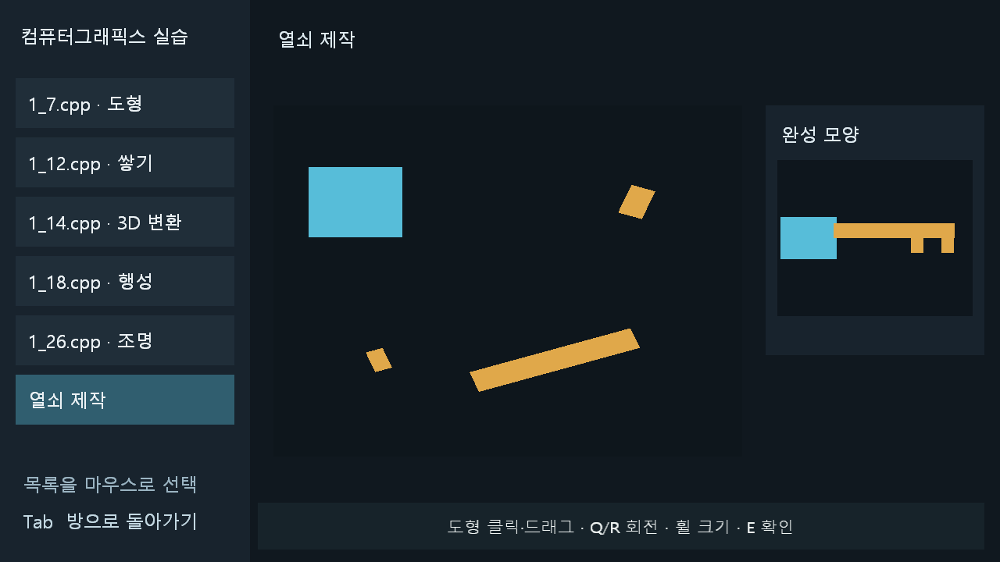

# B-032 — 열쇠 제작 완성 모양 참고 이미지

## 작업 시작

- 날짜 / 담당: 2026-11-23 / 최윤서 작업 지원
- 상태: 완료 / yoon778 / 시작 c6d73b1, 기존 수정 없음
- 요청: 열쇠 제작 시 옆에 완성본 사진을 놓고 참고하여 조립
- 확인: AGENTS, TEAM, 협업 규칙, 공식 기획서 내 방, B-030·031, 새누 SCHOOL-014와 main 공유 기록. 원격 추가 변경 없음
- 범위: ComputerScreen.cpp의 열쇠 화면 배치·참고 이미지, 공식 기획서 해당 설명, 이 기록과 화면 미리보기
- 완료 기준: 열쇠 제작에서만 완성 모양이 옆에 보이고 마우스 조립·회전/크기 조절·E 출력 유지. 다른 다섯 실습·학교·군대·공용 API 변경 없음

## 진행·인계

- 오른쪽 정적 참고 카드에 현재 2D 조립 정답의 크기·방향·색상과 같은 열쇠 그림 표시. 별도 이미지 경로/로딩 없이 기존 workspace 라벨 텍스처에 함께 생성
- 열쇠 제작 영역만 (350,135),600×450으로 배치, 기존 4:3 비율 유지. 다른 실습은 기존 (435,90),720×540 유지. 동일 workspaceCanvas 함수로 렌더·마우스 좌표를 계산
- 정답/오답 상태 문구·퍼즐 가이드선은 추가하지 않음. 현재 사용자 요청에 따라 B-030의 표시 제거 중 완성 모양 참고만 별도로 추가. 수업 목록·조작법·정답 판정·열쇠 출력 동작 유지
- 수정 파일: rooms/home/ComputerScreen.cpp, rooms/home/design/key-puzzle-preview.png, illusion-escape-game-plan.md, 이 기록
- Debug·Release x64 빌드 통과. PreferredToolArchitecture=x64, Release는 기존 검증 방식대로 명령 한정 WholeProgramOptimization=false 사용. 기본 LTCG 링크 검증과 구분
- 숨김 OpenGL 공개 입력 자동 검증: 1280×720·1024×768 합산 64/64 통과. E로 컴퓨터 진입·목록 클릭·도형 드래그/Q/R/휠 조립·E 완성키 1개 출력, 참고 카드 클릭/드래그의 부품 미변경·가짜 출력 없음, 다른 다섯 실습에서 카드 숨김 확인
- 두 해상도 native 화면 및 완성 화면 3장 판독: 카드/그림/문구 잘림 없음, 초기·완성의 카드 픽셀이 같아 정답 상태 피드백을 추가하지 않았음 확인. 최신 초기 화면으로 기존 미리보기 파일 갱신
- 재현: %TEMP%/out-of-scale-home-b032-qa-20261123/compile.cmd → link-run.cmd, results.txt. 빌드 로그는 %TEMP%/out-of-scale-b032-build-debug.log, %TEMP%/out-of-scale-b032-build-release.log. 검증 도구는 제품에 포함하지 않음
- 검증 한계: 드라이버 합성 입력·숨김 native 화면이며 사람의 물리 키보드/마우스 플레이와 구분. 직접 발견 난이도·주관적 품질은 미확인. 표시·좌표 변경 범위이므로 이전 전체 82개 탈출 회귀는 반복하지 않음
- 새누 인계: F4 내부 표시·좌표 계산만 변경. 학교·회사·공용 입력 API 영향 없음
- 커밋 직전 확인: fetch 후 origin/main·origin/saenu 33388d3, origin/yoon778 c6d73b1 추가 변경 없음. 공유 AGENTS·TEAM·SCHOOL-014 확인, 수정 범위 중복 없음
- 커밋 / 푸시: 코드·기획서·미리보기와 이 기록을 같은 커밋으로 yoon778에 저장해 origin/yoon778에 공유. 실제 식별자는 이 파일 git log와 원격 HEAD 확인 기준
- main 통합: 미요청·미수행
- AI 활용: 사용자 요청에 따라 완성 모양과 실제 조립 정답 좌표를 대조하여 참고 화면 작성. 사람 검토 미확인

