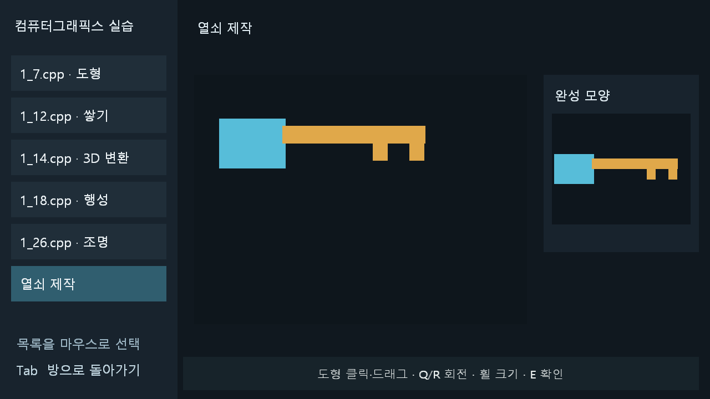

# B-033 — 열쇠 조립 정밀 조작 부담 완화

## 작업 시작

- 날짜 / 담당: 2026-11-23 / 최윤서 작업 지원
- 상태: 완료 / yoon778 / 시작 9163db7 / 기존 수정 없음
- 요청: 열쇠 모양을 정확하게 맞추기 어려움
- 확인: AGENTS, TEAM, 협업 규칙, 공식 기획서 내 방, B-032 및 실행 파일 캐시 복구 기록, 공유 SCHOOL-014
- 범위: CourseworkLabs.cpp/.h의 열쇠 조작·완성 판정, 기획서 해당 문장, 이 기록
- 목표: 정밀하게 수치·각도를 맞추지 않아도 가까이 놓으면 붙고, 동일한 이빨의 숨은 내부 번호 때문에 완성이 거절되지 않음

## 진행·인계

- 파란 머리를 기준으로 금색 도형을 드래그해 놓을 때 위치/머리크기 오차 .18, 각도 오차 .60rad, 상대 크기 오차 .35 이내면 정확한 자리·각도·크기로 보정. 전체 회전/축 대칭을 유지하고 화면 밖 후보는 제외
- 동일한 이빨은 가까운 빈 슬롯을 선택하고, 완성 판정에서도 두 이빨의 자리 교환을 인정. 두 개가 같은 슬롯에 겹친 경우는 완성이 아님
- 실제 부품의 기존 잡기 판정을 우선하고, 안 잡혔을 때만 작은 이빨에 .04 여유 범위 적용. 큰 몸통 클릭을 작은 이빨이 가로채지 않도록 처리
- 참고 카드·기존 조작법·엄격한 최종 형상 확인·E 완성키 출력 유지. 정답/오답 문구·가이드선·자동 전체 조립은 추가하지 않음
- 수정 파일: rooms/home/CourseworkLabs.cpp/.h, rooms/home/design/key-snap-preview.png, illusion-escape-game-plan.md, 이 기록
- Debug·Release x64 빌드 통과. PreferredToolArchitecture=x64, Release는 기존대로 검증 명령 한정 WholeProgramOptimization=false 사용. 기본 LTCG 검증과 구분, 기존 glew32s.pdb 경고는 남아 있음
- 사용자에게 기존 Debug 게임 종료·진행 초기화 동의를 받아 반영 진행. 빌드 전 실제 실행 프로세스 없음 확인. 각 구성의 link.*.tlog만 정확한 빌드 캐시 경로에서 Temp로 보존 이동해 실제 재링크 유도, 프로젝트 설정·다른 캐시는 수정하지 않음
- 실제 Debug·Release TargetPath EXE의 SHA256이 이전과 바뀌고 새 CourseworkLabs.obj보다 이후에 생성된 것을 검사해 통과. 단순 MSBuild 성공 로그만으로 갱신을 판단하지 않음. 전후 해시는 Temp의 before-exe-hashes.json·after-exe-hashes.json에 보존
- 숨김 OpenGL 공개 입력 자동 검증 59/59 통과: 41개 ComputerScreen 입력 검사, 18개 실제 Home 진입·모니터 E·메뉴 클릭·초기 각도 ±.35rad/크기 .85·1.2 그대로 대략 드래그·이빨 자리 교환·E로 실제 월드 완성키 하나 출력. 상태 주입 없이 공개 입력만 사용하고 private 상태는 관찰에만 사용
- 임의 .47rad 전체 회전, 머리 90°·몸통 180° 대칭·이빨 교환 수용. 먼 거리·틀린 각도/크기·중복 슬롯·화면 경계·카드와 바깥 놓기·입력 해제에서 잘못된 스냅/출력 차단. 작은 이빨 잡기 여유와 몸통 우선 선택 확인
- 최종 native 화면 판독: 참고 카드와 동일한 모양으로 보정, 새 정답 문구·가이드선 없음. 스크린샷을 프로젝트 design 폴더에 보존. 검증 입력은 합성이며 사람의 물리 키보드/마우스 완주와 구분
- 재현: %TEMP%/out-of-scale-home-b033-qa-20261123/의 capture.cpp, compile.cmd → link-run.cmd, results.txt, build-debug.log·build-release.log. 이전 전체 82개 탈출 루트는 영향 범위 밖이므로 반복하지 않음
- 미검증: 사람의 직접 조작 감각·주관적 난이도
- 새누 인계: F4 열쇠 실습 내부만 변경, 학교·군대·공용 API 영향 없음
- 커밋 전 확인: fetch 후 origin/main·origin/saenu 33388d3, origin/yoon778 9163db7 추가 변경 없음. 공유 지침·TEAM·SCHOOL-014 및 내 작업 기록 확인, 범위 중복 없음
- 커밋/푸시: 검증한 코드·기획서·화면과 이 기록을 함께 yoon778에 저장해 origin/yoon778에 공유. main 통합 미요청·미수행
- AI 활용: 사용자 피드백으로 조립 접근성 개선 및 동일 도형의 숨은 순서 제약 제거. 사람 검토 미확인

